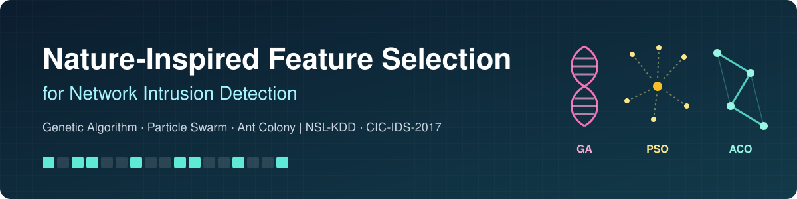
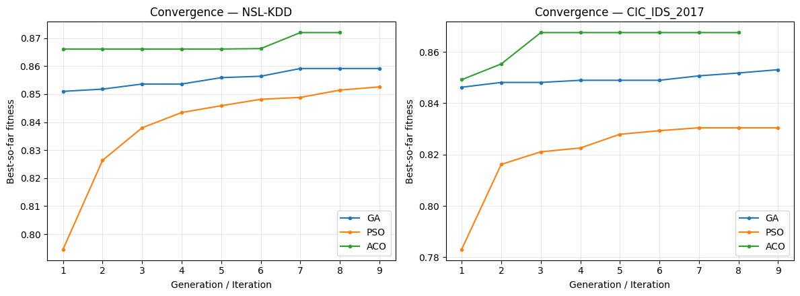
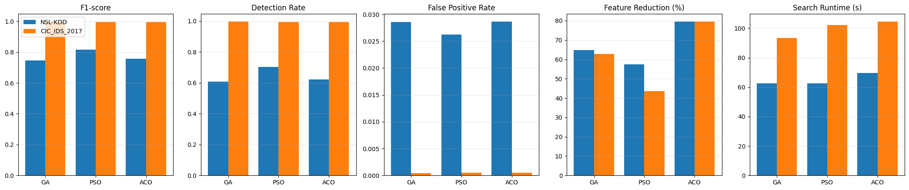
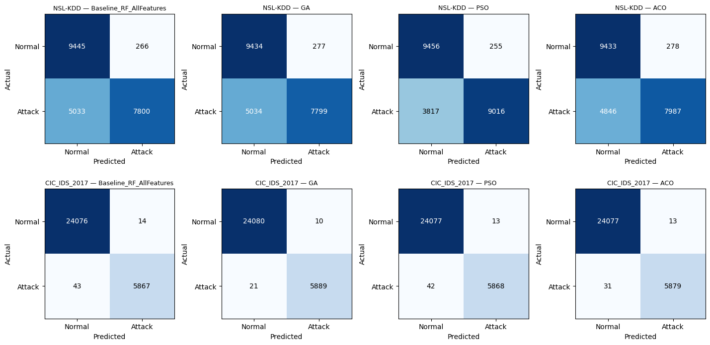
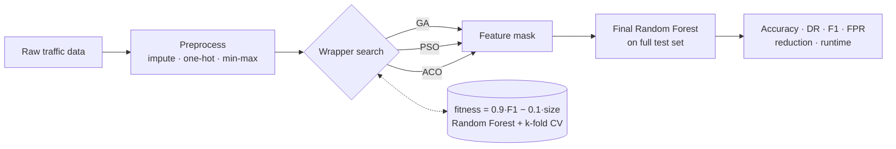

<p align="center">
  
</p>

<p align="center">
  <a href="https://github.com/Najma-Abdulkarim-Nor/nature-inspired-ids-feature-selection/actions/workflows/ci.yml"></a>
  
  
  <a href="LICENSE"></a>
  <a href="https://colab.research.google.com/github/Najma-Abdulkarim-Nor/nature-inspired-ids-feature-selection/blob/main/notebooks/nature_inspired_feature_selection.ipynb"></a>
</p>

<p align="center">
  <b>Which nature-inspired algorithm finds the best features for an intrusion detection system?</b><br>
  GA, PSO and ACO compared under one identical, reproducible protocol on NSL-KDD and CIC-IDS-2017.
</p>

<p align="center">
  <a href="#-quick-start">🚀 Quick start</a> ·
  <a href="#-results">📈 Results</a>
</p>

---

## ✨ Highlights

- **Fair comparison.** All three algorithms use the same data, preprocessing, classifier, fitness function and metrics, so any difference comes from the search strategy alone.
- **Up to 80 % fewer features, same or better detection.** On NSL-KDD, PSO raises the detection rate by **+9.5 points** over the all-features baseline.
- **Written from scratch.** GA, PSO and ACO are implemented in plain NumPy, with no metaheuristic libraries, and each follows the paper's pseudocode.
- **Reproducible.** Every run is seeded, settings live in YAML configs, one command rebuilds every table and figure, and unit tests run in CI.

## 📈 Results

Scores on the full held-out test set (100-tree Random Forest), pilot-scale search (`configs/fast.yaml`):

<table>
<tr><th rowspan="2">Method</th><th colspan="4">NSL-KDD (122 features)</th><th colspan="4">CIC-IDS-2017 (78 features)</th></tr>
<tr><th>Features</th><th>Detection rate</th><th>F1</th><th>FPR</th><th>Features</th><th>Detection rate</th><th>F1</th><th>FPR</th></tr>
<tr><td>Baseline (all)</td><td>122</td><td>0.608</td><td>0.746</td><td>0.027</td><td>78</td><td>0.993</td><td>0.995</td><td>0.0006</td></tr>
<tr><td>GA</td><td>43 <sub>(−65%)</sub></td><td>0.608</td><td>0.746</td><td>0.029</td><td>29 <sub>(−63%)</sub></td><td><b>0.996</b></td><td><b>0.997</b></td><td><b>0.0004</b></td></tr>
<tr><td>PSO</td><td>52 <sub>(−57%)</sub></td><td><b>0.703</b></td><td><b>0.816</b></td><td><b>0.026</b></td><td>44 <sub>(−44%)</sub></td><td>0.993</td><td>0.995</td><td>0.0005</td></tr>
<tr><td>ACO</td><td><b>25</b> <sub>(−80%)</sub></td><td>0.622</td><td>0.757</td><td>0.029</td><td><b>16</b> <sub>(−80%)</sub></td><td>0.995</td><td>0.996</td><td>0.0005</td></tr>
</table>

| | Best choice when you need… |
|---|---|
| 🐜 **ACO** | the **smallest model**: about 80 % of features removed on both datasets |
| 🐦 **PSO** | the **highest detection rate** on the harder NSL-KDD benchmark |
| 🧬 **GA** | the **best all-round scores** on CIC-IDS-2017 |

Over repeated runs, Wilcoxon signed-rank and Friedman tests found **no statistically significant
difference** among the three algorithms at the pilot sample size (Friedman p = 0.25 on NSL-KDD,
p = 0.55 on CIC-IDS-2017). Full numbers: [`results/main_results.csv`](results/main_results.csv).

<p align="center">
  
</p>
<details>
<summary><b>More figures</b>: algorithm comparison and confusion matrices</summary>
<br>


</details>

## 🧠 How it works



| Algorithm | How a feature subset is represented | How the search moves |
|---|---|---|
| **GA** | Binary chromosome (1 = keep) | Roulette-wheel selection, single-point crossover (p = 0.8), bit-flip mutation (p = 0.02) |
| **PSO** | Continuous position, sigmoid-thresholded | Inertia decays 0.9 → 0.4, c₁ = c₂ = 2.0 |
| **ACO** | Pheromone level per feature | τ^α·η^β sampling (α = 1, β = 2), evaporation ρ = 0.1, subset size 20–80 % |

All three stop early when the best fitness has not improved for `patience` generations.

## 🚀 Quick start

```bash
git clone https://github.com/Najma-Abdulkarim-Nor/nature-inspired-ids-feature-selection.git
cd nature-inspired-ids-feature-selection
pip install -e .
```

Download the datasets into `data/` (see [data/README.md](data/README.md)), then:

```bash
nifs run                          # baseline + GA, PSO, ACO on both datasets (a few minutes)
nifs run --datasets nsl-kdd --algorithms PSO ACO
nifs stats                        # repeated runs + Wilcoxon / Friedman tests
nifs run -c configs/paper.yaml    # full paper-scale settings (several hours)
```

Each run writes `main_results.csv`, `selected_features.json`, the config it used and all figures
to the output folder (`results/` by default).

### Use it as a library

```python
from nifs import load_dataset, make_fitness_fn, run_pso, evaluate_subset

X_train, X_test, y_train, y_test, names = load_dataset("nsl-kdd", data_dir="data")
fitness, n = make_fitness_fn(X_train, y_train)
result = run_pso(fitness, n, pop_size=12, n_gen=8)

print([f for f, keep in zip(names, result.mask) if keep])
print(evaluate_subset(result.mask, X_train, y_train, X_test, y_test))
```

### Prefer notebooks?

[`notebooks/nature_inspired_feature_selection.ipynb`](notebooks/nature_inspired_feature_selection.ipynb)
is the original research notebook, with all outputs saved. It runs on Google Colab or locally.

## ⚙️ Configuration

| Setting | `fast.yaml` | `paper.yaml` |
|---|---:|---:|
| Population / swarm / colony | 12 | 50 |
| Generations / iterations | 8 | 100 |
| CV folds in fitness | 3 | 5 |
| Trees during search | 40 | 100 |
| Training rows for fitness | 6,000 | all |
| Runs for statistics | 5 | 30 |

Both configs evaluate the final subset on the **full** test set, so the reported metrics are
trustworthy in either mode.

## 📁 Project structure

```
├── src/nifs/
│   ├── algorithms/        # ga.py · pso.py · aco.py
│   ├── data.py            # NSL-KDD / CIC-IDS-2017 loaders + preprocessing
│   ├── fitness.py         # shared wrapper fitness function
│   ├── evaluation.py      # test-set metrics
│   ├── stats.py           # Wilcoxon + Friedman tests
│   ├── plotting.py        # convergence, comparison, confusion-matrix figures
│   └── cli.py             # `nifs run` / `nifs stats`
├── configs/               # fast.yaml · paper.yaml
├── tests/                 # pytest suite (runs on synthetic data, no download needed)
├── notebooks/             # original research notebook
├── results/               # published results and figures
└── data/                  # datasets go here (not tracked by git)
```

## 🧪 Development

```bash
pip install -e ".[dev]"
pytest          # unit tests
ruff check .    # lint
```

## 📚 Citation

```bibtex
@misc{nour2026natureinspired,
  author = {Nour, Najma Abdulkarim},
  title  = {Nature-Inspired Feature Selection for Intrusion Detection Systems:
            A Comparative Study of Genetic Algorithm, Particle Swarm Optimization,
            and Ant Colony Optimization},
  year   = {2026},
  note   = {MAI 650 -- Nature-Inspired Computing, Canadian University Dubai},
  url    = {https://github.com/Najma-Abdulkarim-Nor/nature-inspired-ids-feature-selection}
}
```

## 🙏 Acknowledgements

Datasets are from the [Canadian Institute for Cybersecurity, University of New Brunswick](https://www.unb.ca/cic/datasets/index.html).
Code is released under the [MIT License](LICENSE); the datasets keep their original terms.
